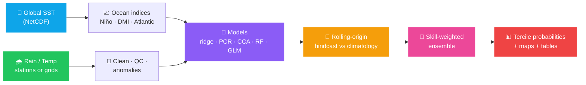

<div align="center">


### 🌊 Ocean signals in. 🌧️ Honest forecasts out.


**[⚡ Quick start](#-quick-start)** ·
**[🧭 Pick a workflow](#-pick-your-workflow)** ·
**[📖 Read a forecast](#-reading-a-forecast)** ·
**[🛡️ Design principles](#️-design-principles)** ·
**[⚠️ Limitations](#️-limitations)**

</div>

---

Seasonal and subseasonal forecasting of **🌧️ rainfall, 🌡️ temperature, ☔ rainfall occurrence and 🌊 sea-surface temperature** from ocean–atmosphere teleconnections (**ENSO, Indian Ocean Dipole, tropical Atlantic and Pacific indices**), for **📍 stations and 🗺️ gridded fields**, with **tercile probabilities** and an out-of-sample **hindcast verification record** for every forecast.

Built for **East Africa** (Ethiopia, Tigray, the Upper Blue Nile basin), but nothing in the code is region-specific: regions, seasons and predictors live in YAML files.

> [!WARNING]
> **Research prototype.** All 105 automated tests use synthetic data with planted signals. They show the code works and does **not** leak future information, **not** that forecasts are skilful on your data. Validate on your own hindcasts before any operational use (see [Limitations](#️-limitations)).

---

## 🔭 How it works



## 🧭 Pick your workflow

Click a question to expand its command.

<details>
<summary><b>⏱️ &nbsp;What will the next few weeks be like?</b> &nbsp;·&nbsp; <i>Subseasonal (weeks 2–4, 3–6, or any single week)</i></summary>

```bash
python main.py --stations data/stations/ --subseasonal \
    --init-date 2026-11-16 --lead-weeks 2 4
```
</details>

<details>
<summary><b>📍 &nbsp;What will JJAS / OND / ONDJ… be like at each station?</b> &nbsp;·&nbsp; <i>Seasonal, station</i></summary>

```bash
python main.py --stations data/stations/ --station-season OND \
    --station-forecast --init-month 9 --target-year 2026
```
</details>

<details>
<summary><b>🗺️ &nbsp;Same, but as maps</b> &nbsp;·&nbsp; <i>Seasonal, gridded (rainfall, Tmax, Tmin, SST)</i></summary>

```bash
python main.py --grid-forecast --grid-variable precipitation \
    --season OND --init-month 9 --target-year 2026
```
</details>

<details>
<summary><b>☔ &nbsp;How many days will be wet?</b> &nbsp;·&nbsp; <i>Rainfall occurrence</i></summary>

Add a wet-day threshold to any station run:

```bash
--wet-day-threshold 1.0
```
</details>

<details>
<summary><b>🌊 &nbsp;What will Niño 3.4 and the IOD do over 12 months?</b> &nbsp;·&nbsp; <i>Ocean indices</i></summary>

```bash
python main.py --input sst.nc
```
</details>

<details>
<summary><b>🏜️ &nbsp;Was this season drier than normal?</b> &nbsp;·&nbsp; <i>Drought history (SPI / SPEI)</i></summary>

```bash
--index spi        # or: spei | both
```
</details>

<details>
<summary><b>🔗 &nbsp;Which ocean regions relate to my rainfall, and at which lag?</b> &nbsp;·&nbsp; <i>Teleconnection analysis</i></summary>

```bash
--teleconnection
```
</details>

## 🧰 Toolbox

| | |
|---|---|
| 🧠 **Methods** | Ridge regression · Principal-component regression · CCA · Random forest · Binomial GLM (occurrence) · optional calibrated dynamical-model member · skill-weighted multi-model **ensemble**, all benchmarked against **climatology** |
| ✅ **Verification** | RPSS · Heidke · Brier skill · ROC area · CRPS · correlation / RMSE / bias · reliability tables · accuracy / POD / FAR / CSI for events, with **90% block-bootstrap intervals** |
| 📦 **Outputs** | CSV and Excel tables · NetCDF and multi-band GeoTIFF grids · anomaly / tercile-probability / hindcast-skill maps · machine-readable run metadata |

## 🛡️ Design principles

| | Principle | What it means |
|---|---|---|
| 🚫🔮 | **No future data** | Predictors use only data available at the initialization date. Terciles, model selection, bias correction and ensemble weights use training years only. Tested end to end: every workflow runs on clean data and again with the future replaced by absurd values, and the forecasts must be identical (`tests/test_leakage_e2e.py`). |
| 🔁 | **Rolling-origin validation** | Each past year is forecast from earlier years only. Random splits are never used. |
| 🥇 | **Climatology is the benchmark** | A model must beat climatology's leave-one-out error by a margin (`--min-gain`, default 8%) at each station or grid cell, otherwise that location keeps climatology. A forecast labelled `climatology` means *"no predictor showed skill here."* |
| 🤫❌ | **Nothing is guessed silently** | Ambiguous dates stop the run. Every repair of the input data is counted in a quality report. |

## ⚡ Quick start

```bash
git clone https://github.com/goikelem/GS2STF.git
cd GS2STF
pip install -r requirements.txt

python tests/test_demo.py        # ~1 minute: synthetic data, checks the install
sh examples/run_demo.sh          # a tour of the outputs on synthetic data -> demo_out/
python main.py --help
```

> [!TIP]
> The demo's relationships are *planted*, so its skill looks far better than real data will give. Use it to learn the formats, not to judge the method.

### 🚀 A first run on your own data

Run everything from the repository root. Paths are examples. Expand each step.

<details open>
<summary><b>1️⃣ &nbsp;Ocean predictors from a global SST NetCDF</b></summary>

`--fast` gives quicker validation; drop it for the full run.

```bash
python main.py --input data/sst/sst_era5.nc --output outputs/sst --fast
# -> outputs/sst/indices/all_predictors_monthly.csv
```
</details>

<details>
<summary><b>2️⃣ &nbsp;A gridded seasonal forecast</b> (OND rainfall from data through September)</summary>

```bash
python main.py --grid-forecast --grid-variable precipitation \
    --season OND --init-month 9 --target-year 2026 \
    --sst-indices outputs/sst/indices/all_predictors_monthly.csv \
    --grid-region Ethiopia --grid-coarsen 5 --methods ridge,pcr \
    --grid-output outputs/grid
```
</details>

<details>
<summary><b>3️⃣ &nbsp;Station forecasts</b> (a daily CSV, or a folder of CSV files)</summary>

```bash
python main.py --stations data/stations/ \
    --station-season OND --station-forecast --init-month 9 --target-year 2026 \
    --sst-indices outputs/sst/indices/all_predictors_monthly.csv \
    --wet-day-threshold 1.0 --station-output outputs/stations
```
</details>

<details>
<summary><b>4️⃣ &nbsp;Weeks 2–4 for a given issue date</b></summary>

```bash
python main.py --stations data/stations/ --subseasonal \
    --init-date 2026-11-16 --lead-weeks 2 4 \
    --sst-indices outputs/sst/indices/all_predictors_monthly.csv \
    --station-output outputs/subseasonal
```
</details>

`data/` and `outputs/` are git-ignored, so your data and results are never committed.

## 📥 Input data

<details>
<summary><b>📍 Station observations</b> (daily CSV)</summary>

- **Long format:** `Station,Date,Lat,Lon,Variable,Value`
- **Simple format:** `Station,Date,lat,long,value`
- A single file or a folder of files. Rainfall in mm/day, temperature in °C.

The loader tolerates a byte-order mark, UTF-8 or Latin-1, `,` `;` tab or `|` separators, decimal commas, `NA` / `-` / sentinel codes, and `T` (trace) rainfall.

It **refuses** ambiguous day/month dates until you say which (`--station-dayfirst` or `--station-monthfirst`), and warns about probable unit problems (for example temperatures in tenths of degrees). Every run writes `station_data_quality_report.json` and `station_coverage.csv`.
</details>

<details>
<summary><b>🗺️ Gridded data</b> (NetCDF with time, latitude, longitude)</summary>

- 🌧️ Rainfall (e.g. CHIRPS)
- 🌡️ Tmin and Tmax (e.g. ERA5 / CHIRTS)
- 🌊 SST (e.g. ERA5)

File names are matched by pattern, so `prcp-chirps-ethio-198101_202609.nc` is found even if the configured name has a different end date.
</details>

<details>
<summary><b>🌊 Ocean predictors</b></summary>

A monthly table of index anomalies: **R34, WIOD, EIOD, DMI, Niño 1+2 / 3 / 4, tropical Indian Ocean, tropical North and South Atlantic, Atlantic gradient**. Written by the SST workflow; you can supply your own columns.
</details>

<details>
<summary><b>➕ Optional</b></summary>

- Dynamical-model exports (CSV, same initialization month as the forecast)
- Polygon files (`.geojson` / `.shp`, WGS84) for clipping
- `ENSO-Years.xlsx` for ENSO composites
</details>

## 📖 Reading a forecast

Each forecast row carries the expected value, its anomaly, **three tercile probabilities**, the tercile cut points, the predictors used, the ensemble weights, and the initialization date, lead and target period.

```text
Station, lat, lon, Forecast_Period, Variable, Forecast, Anomaly,
Climatology, P_below, P_normal, P_above, Tercile_lower, Tercile_upper,
Predictors, N_train_years, Method, init_date, lead_months, target_start, target_end, …
```

| Signal | Interpretation |
|---|---|
| 🟢 Lower end of pooled RPSS interval **> 0** | The model beats climatology out of sample (check `hindcast_pooled_*.csv`, `method_comparison_*.csv`) |
| ⚪ Probabilities near **33 / 33 / 33** | No signal |
| 🔘 Method = `climatology` | No predictor showed skill at this location |

## 🗂️ Repository layout

```text
main.py                  single entry point for all workflows
config/                  datasets.yaml, forecast_settings.yaml, regions.yaml
src/
  data_ingestion/        station CSV loader, NetCDF loader, validation
  preprocessing/         station and grid processing, anomalies, regridding, bias correction
  teleconnections/       SST indices, ENSO / IOD events, lag analysis, correlation maps
  forecasting/           seasonal, subseasonal, ensemble, GLM, dynamical, index forecasting
  verification/          hindcasts, cross-validation, skill and probabilistic scores
  spatial/               forecast and station maps, polygon clipping, grid statistics
  export/                NetCDF, GeoTIFF, CSV / Excel, figures
  drought_indices/       SPI / SPEI workflow
examples/                synthetic demo data generator and demo script
tests/                   automated tests, including the end-to-end leakage audit
docs/                    user guide and development notes
legacy/                  two superseded files kept for reference (not used)
```

## ⚙️ Configuration

Defaults live in three YAML files in `config/`:

| File | Controls |
|---|---|
| `datasets.yaml` | dataset paths and file names |
| `forecast_settings.yaml` | seasons, methods and thresholds |
| `regions.yaml` | ocean and study regions |

To add a season, add a line such as `NDJF: [11, 12, 1, 2]` under `seasons.station`. Set `S2S_CONFIG_DIR` to use a different config folder.

## 🧪 Testing

```bash
python tests/test_demo.py              # quick install check
python tests/test_leakage_e2e.py       # end-to-end leakage audit
for t in tests/test_*.py; do python "$t"; done
```

Each file prints `PASS` or `FAIL` per test. If you add a predictor or data source, extend `tests/test_leakage_e2e.py` so the audit covers it.

## ⚠️ Limitations

<details open>
<summary><b>Read these before trusting any output</b></summary>

- **Skill on real data is unverified.** All tests use synthetic data. Real skill will be lower and varies by region and season.
- **Reading real NetCDF files** has not been exercised by the original author's build environment. Try the grid workflow on a small clipped region first.
- Default thresholds (e.g. `--min-gain 0.08`) were set on synthetic experiments: re-check them on your hindcasts.
- No dynamical climate model is run; subseasonal forecasts use only ocean indices and persistence (no MJO).
- Probabilities assume Gaussian errors on the modelling scale (square root for rainfall); check `hindcast_reliability_*.csv`.
- The `East_Africa` and `Upper_Blue_Nile` regions are approximate boxes: use a polygon for exact limits.

**Not implemented:** subseasonal forecasts for grids · rainfall amounts by GLM (only occurrence) · XGBoost / LightGBM / LSTM / CNN for seasonal and weekly targets · atmospheric-circulation and soil-moisture predictors · Ethiopian-calendar date conversion.
</details>

## 📚 Documentation

| 📄 Document | Contents |
|---|---|
| [`docs/USER_GUIDE.md`](docs/USER_GUIDE.md) | which command for which question, the output dictionary, how to read results, common messages |
| [`docs/DEVELOPMENT_NOTES.md`](docs/DEVELOPMENT_NOTES.md) | module map, design decisions and every fix made during development |
| [`docs/METHODS_original_README.md`](docs/METHODS_original_README.md) | methods of the original SST-index project |
| `python main.py --help` | every option with its default |

## 🙏 Data sources

The package reads, but does not distribute, products such as **CHIRPS** (rainfall), **CHIRTS** and **ERA5** (temperature), and **ERA5** (SST). Please follow each provider's terms and cite them when you publish results.

## 🤝 Contributing

Issues and pull requests are welcome. Please run the full test suite and the leakage audit before submitting, and describe any change that can alter forecast values.

## 📜 License

No license has been chosen yet. Add a `LICENSE` file (for example MIT or Apache-2.0) before making the repository public, then update this section and the badge above.

---

<div align="center">

🌊 **Ocean in, probabilities out, and always compared to climatology.** 🌧️

</div>
